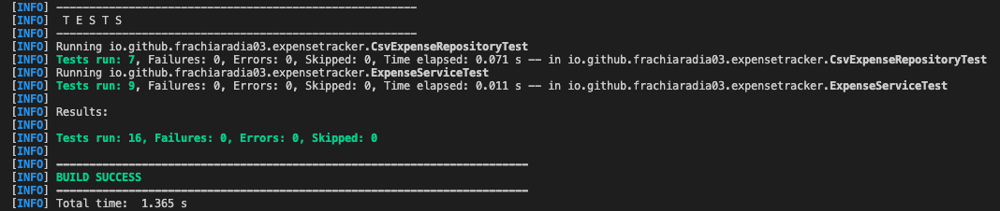

# Java Expense Tracker

A Java command-line application for managing personal expenses.

Developed using Java 17, object-oriented programming,
CSV file persistence, Maven and JUnit 5.

## Project Overview

Java Expense Tracker is a personal finance management
application that allows users to record, organize,
filter and analyze expenses through an interactive
command-line interface.

The project demonstrates practical Java development,
object-oriented design, file handling, input validation
and automated software testing.

This is an independent portfolio project.

## Features

- Add new expenses
- View all recorded expenses
- Filter expenses by category
- Calculate total expenses
- Calculate spending by category
- Generate monthly spending summaries
- Delete expenses by ID
- Save expenses to CSV
- Automatically load saved expenses
- Validate user input
- Handle file reading and writing errors
- Preserve expense IDs across normal save/load operations

## Technologies Used

- Java 17
- Object-Oriented Programming
- Java Collections Framework
- Java File I/O
- CSV
- BigDecimal
- Maven
- JUnit 5
- Git & GitHub

## Application Architecture

The project follows a modular object-oriented structure.

### App.java

Handles the interactive command-line interface,
user input and application execution.

### Expense.java

Represents an individual expense.

Each expense contains:

- ID
- Description
- Amount
- Category
- Date

### Category.java

Defines the available expense categories using
a Java enumeration.

### ExpenseService.java

Implements the main application logic:

- Expense creation
- Expense deletion
- Category filtering
- Total calculations
- Monthly summaries
- Expense ID management

### CsvExpenseRepository.java

Handles CSV persistence:

- Saving expense records
- Loading saved records
- CSV parsing and escaping
- Data validation
- File error handling

## Project Structure

```text
java-expense-tracker/
|
|-- src/
|   |-- main/java/
|   |   |-- io/github/frachiaradia03/expensetracker/
|   |       |-- App.java
|   |       |-- Expense.java
|   |       |-- Category.java
|   |       |-- ExpenseService.java
|   |       |-- CsvExpenseRepository.java
|   |
|   |-- test/java/
|       |-- io/github/frachiaradia03/expensetracker/
|           |-- ExpenseServiceTest.java
|           |-- CsvExpenseRepositoryTest.java
|
|-- data/
|-- screenshots/
|-- pom.xml
|-- README.md
|-- .gitignore
```

## Requirements

- JDK 17 or newer
- Apache Maven

## Installation

### 1. Clone the repository

```bash
git clone https://github.com/frachiaradia03/java-expense-tracker.git
```

### 2. Open the project directory

```bash
cd java-expense-tracker
```

### 3. Compile the application

```bash
mvn clean package
```

### 4. Run the application

```bash
java -cp target/classes io.github.frachiaradia03.expensetracker.App
```

## Main Menu

The application provides the following options:

```text
========================================
          JAVA EXPENSE TRACKER
========================================

              MAIN MENU

1. Add new expense
2. View all expenses
3. Filter expenses by category
4. View total expenses
5. View category summary
6. View monthly summary
7. Delete an expense
8. Save expenses
0. Exit
```

## CSV Persistence

Expense records are saved in:

```text
data/expenses.csv
```

Example:

```csv
id,description,amount,category,date
1,"Grocery shopping",45.90,FOOD,2026-10-15
2,"Bus ticket",12.50,TRANSPORT,2026-10-14
```

The application automatically loads existing data
when launched.

Users can save manually or save when exiting.

The application validates CSV content and handles
file access errors.

Personal expense data is excluded from Git.

## Automated Testing

The project includes 16 automated tests using JUnit 5.

### ExpenseServiceTest

9 tests covering:

- Expense creation
- Input validation
- Total calculations
- Category filtering
- Monthly calculations
- Expense deletion
- ID restoration
- Duplicate ID detection
- Collection encapsulation

### CsvExpenseRepositoryTest

7 tests covering:

- Missing CSV files
- Saving and loading expenses
- Special character handling
- Invalid CSV headers
- Invalid amounts
- Duplicate IDs
- Preservation of existing data on failed writes

### Running Tests

```bash
mvn clean test
```

Expected results for the included test suite:

```text
Tests run: 16
Failures: 0
Errors: 0
Skipped: 0

BUILD SUCCESS
```

## Test Results



## Design Decisions

### BigDecimal for Monetary Values

BigDecimal is used instead of floating-point types
to represent monetary amounts accurately.

### Object-Oriented Design

Application responsibilities are separated
across dedicated Java classes.

### CSV Persistence

The application stores data locally using
a simple CSV-based repository.

### Input Validation

Invalid amounts, dates, categories and other
incorrect inputs are handled by the application.

## Limitations

- The application uses a command-line interface.
- CSV persistence is intended for local use.
- Concurrent multi-user access is not supported.
- Multiline descriptions are not supported.
- Expense identifiers may be reused after deleting
  the highest ID and restarting the application.

## Project Purpose

This application was developed as an independent
software engineering portfolio project.

It demonstrates Java programming, object-oriented
design, file handling and automated testing.

## Author

Francesco Chiaradia